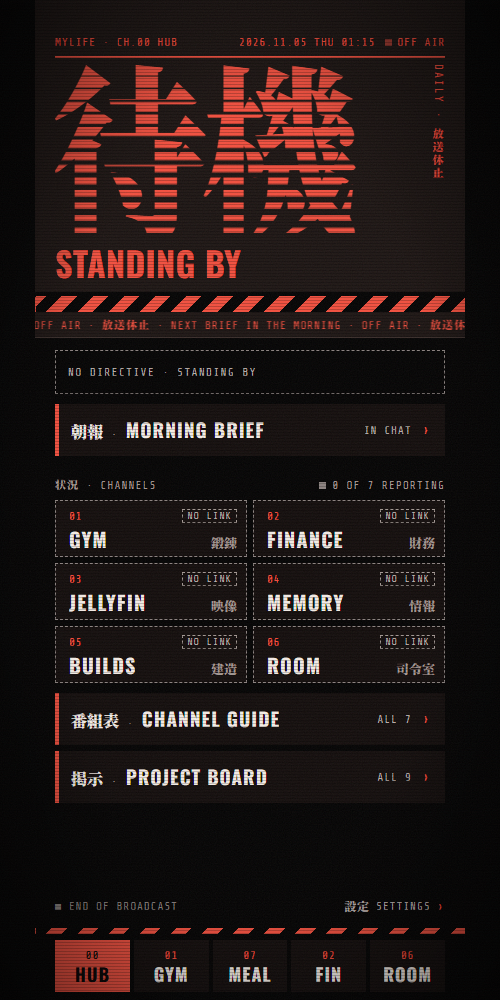
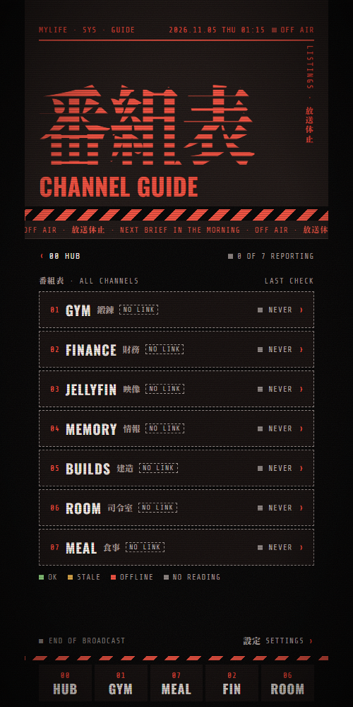
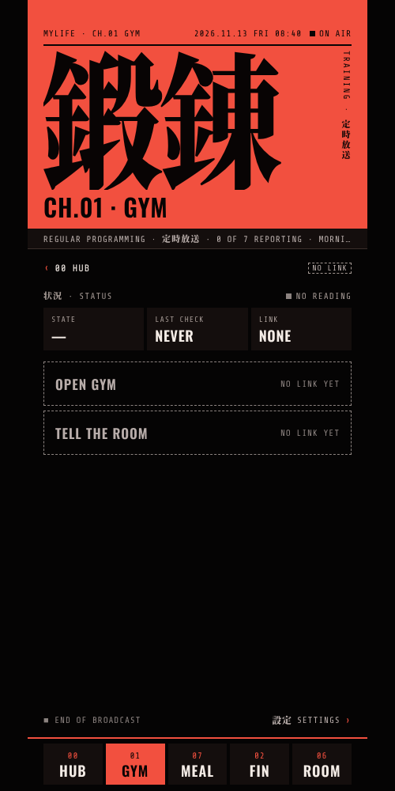
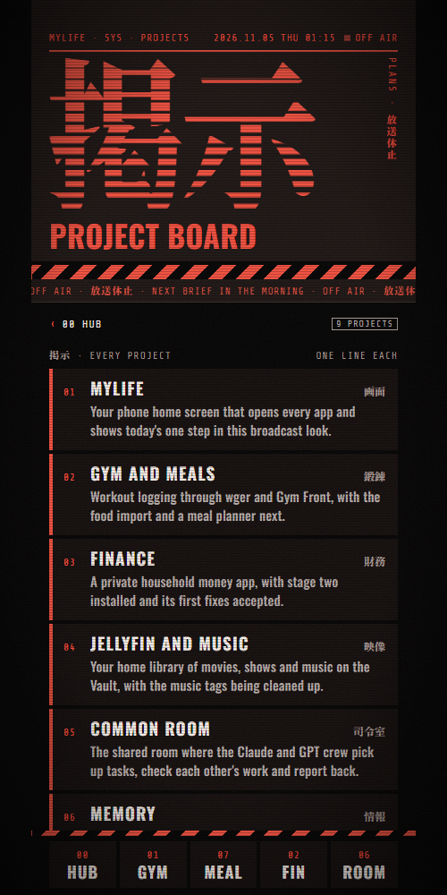
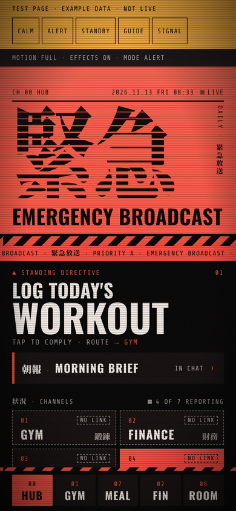

# MyLife Hub

A phone home screen for a self-hosted home lab, styled like a late-night TV broadcast. One page shows today's one next step, a tile for every app in the house, and a channel guide that says which apps are reachable. It is plain HTML, CSS and JavaScript, so it opens straight from a file with no server, no build step and no framework.

  
  
  
  
  

**In one minute:** I designed this home screen and its rules, and directed AI coding agents to build it. Its main rule is that it never pretends: if it can't verify an app's status, it says UNKNOWN instead of showing a green light. It's about 40 KB of plain JavaScript with no framework, no build step and no network calls. The [case study](CASE_STUDY.md) covers why I built it and what I learned. Open `index.html` in any browser to try it.

## What it does

- **Home (CH.00).** It shows today's directive, or **NO SIGNAL** by day and **STANDING BY** at night (22:00 to 06:00 on the device clock). Six channel tiles sit below it, with links to the Morning Brief, the Channel Guide and the Project Board.
- **Channel Guide.** Every channel gets a row with its state (OK, STALE, OFFLINE or NO READING) and the time of its last check.
- **Channel pages** (`signal.html?ch=01` and so on). Each page has its status and an **OPEN** button for that app.
- **Project Board.** One plain-English line per project.
- **Settings.** You can pick the accent colour (red, orange or gold) and turn motion and the CRT effects on or off. These settings stay in the browser's `localStorage`.
- **The hub is honest about what it doesn't know.** It fetches nothing, posts nothing and probes nothing. A tile shows a state only when a status file (`feed.js`) supplies one with a source and a check time. If that file is missing, older than 24 hours or can't be verified, every tile reads UNKNOWN instead of guessing.

## How to run it

Open `index.html` in a browser. That's the whole setup. To make the tiles open your own apps, put full `http://` or `https://` addresses into `links.js`. Any channel left `null` is drawn as a marked LINK PENDING placeholder.

`test-states.html` shows the screens with clearly labelled example data, which is useful for seeing the alert and healthy moods without a live feed.

## How it was built

Shane designed MyLife and wrote the specs: the screens, the rules for what the hub may and may not claim, the look, and the acceptance checks. He didn't write the code. AI coding agents built it from those specs. Claude Code seats did the building, working as tasks on a shared task board ([Common Room](https://github.com/SwagLordPrime/common-room-showcase)). A separate reviewer seat (OpenAI Codex) checked each version against the spec before it was accepted. It went through three versions:

1. **v1:** the static hub, every state UNKNOWN by design until a real check feeds it.
2. **v2:** real app links, with labels saying where each one works (home network only, PC only).
3. **v3:** the broadcast look, local fonts, all 11 screens, and the Project Board.

Fonts: Oswald, Share Tech Mono and a subset of Noto Serif JP, all under the SIL Open Font License 1.1. The details are in [`fonts/FONTS.md`](fonts/FONTS.md).

## What's different in this public copy

This is the live hub with private details taken out:
- every app address in `links.js` is empty (the real ones point at a home network and a private VPN);
- one channel that pointed to a private project was replaced with a neutral **MEMORY** channel;
- one project line was removed, and a client's name was made generic.

Nothing else in the code was changed.
